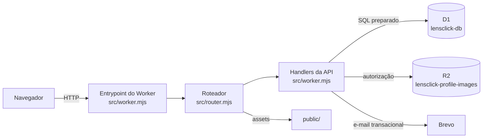

# AI_CONTEXT — Guia operacional para IAs no repositório LensClick

> Este documento é o ponto de entrada obrigatório para qualquer IA que vá analisar, planejar ou modificar este repositório. Ele **não substitui** a documentação permanente — ele **indexa** e estabelece **como trabalhar**. Quando precisar de detalhe, consulte as fontes citadas na seção 4.

---

## 1. Propósito

Este guia existe para garantir que uma IA:

- Entenda a identidade, a arquitetura e as restrições do LensClick **antes** de tocar no código.
- Siga o mesmo procedimento que a equipe humana usa (Git, migrações, testes, segurança).
- Não invente fatos, não duplique documentação existente e não trate roadmap como implementação.
- Produza alterações pequenas, reversíveis e alinhadas às decisões arquiteturais vigentes.

Ele deve **envelhecer mais lentamente** que `docs/HANDOFF.md`: evita números mutáveis (contagem de testes, linhas de arquivo, branches pendentes) e prioriza regras e referências estáveis.

---

## 2. Identidade do produto

- **LensClick** é uma plataforma premium para fotógrafos: site institucional + área autenticada, executados em **Cloudflare Workers**.
- Dados estruturados no **D1**; imagens profissionais no **R2** (bucket privado, nunca público por URL direta).
- Frontend em **HTML/CSS/JS vanilla**, sem framework, com i18n PT/EN.
- Ambiente oficial: `https://lensclick.renato-aparecido-business.workers.dev`.
- Escopo atual (Fase 1): landing page, cadastro/login reais, recuperação de senha via Brevo, central autenticada de conta, perfil profissional, portfolio (até 12 imagens), página pública do fotógrafo, mensagens de contato, newsletter. **Não há** dashboard de agendamentos.
- Termos de Uso e Política de Privacidade ainda requerem revisão institucional antes de publicação comercial.

Detalhes de visão e escopo: `docs/CONTEXTO_PROJETO.md`.

---

## 3. Arquitetura



- **Worker único** (`src/worker.mjs`) executa os handlers; `src/router.mjs` centraliza o catálogo e o despacho de `/api/*`, além da separação para os assets de `public/`.
- `run_worker_first` força o Worker a interceptar `/api/*`, `/` e `/*.html`.
- Backend e frontend compartilham o **mesmo domínio** (sem CORS entre origens).
- Configuração de bindings: `wrangler.jsonc`.

Decisões arquiteturais documentadas (15 decisões em um único documento): `docs/DECISOES_TECNICAS.md`.

---

## 4. Fontes de verdade

**Princípio:** documentação descreve; implementação prova. Quando documentação e implementação divergirem sobre o estado atual, **registre a divergência** e use a **implementação observável** para determinar o que existe de fato. As decisões arquiteturais documentadas explicam a **intenção** e a **justificativa** — não diminuem sua importância: a implementação prova o estado atual; as decisões documentadas explicam por que esse estado é o que é.

A fonte primária depende do tipo de pergunta:

| Pergunta | Fonte primária | Fonte secundária |
|---|---|---|
| O que **ESTÁ** implementado? | Implementação executável/observável: `src/`, `public/`, `migrations/`, `test/`, `wrangler.jsonc`, workflows e estado Git quando aplicável | Documentação (para contexto) |
| **POR QUE** uma decisão foi tomada? | `docs/DECISOES_TECNICAS.md` (14 decisões arquiteturais documentadas) | `docs/DOCUMENTACAO_TECNICA.md` (seção 14) |
| O que **SERÁ** feito? | `docs/ROADMAP_EVOLUCAO.md` (intenção futura, não implementação) | — |
| **ONDE ESTAMOS** operacionalmente? | `docs/HANDOFF.md` (validado contra Git/workspace quando necessário) | Estado Git ao vivo |
| **COMO** uma IA deve trabalhar? | Este `docs/AI_CONTEXT.md` e `CONTRIBUTING.md` | `docs/CONTEXTO_PROJETO.md` |

### Documentos de referência

| Documento | Papel | Mutabilidade |
|---|---|---|
| `docs/CONTEXTO_PROJETO.md` | Onboarding permanente (visão, stack, convenções, débitos) | Baixa |
| `docs/DECISOES_TECNICAS.md` | Decisões arquiteturais **já tomadas** | Baixa |
| `docs/ROADMAP_EVOLUCAO.md` | Documento vivo — **intenção** futura, não implementação | Alta |
| `docs/DOCUMENTACAO_TECNICA.md` | Manual técnico detalhado (API, MER, DER, segurança) | Média |
| `docs/HANDOFF.md` | Estado operacional mutável (HEAD, branches, PRs, tarefas) | Muito alta |
| `DESIGN_SYSTEM.md` | Tokens visuais e componentes | Baixa |
| `README.md` | Execução local e verificações | Média |
| `CONTRIBUTING.md` | Fluxo Git/GitHub da equipe | Baixa |
| `wrangler.jsonc` | Bindings e configuração do Worker | Baixa |
| `migrations/*.sql` | Esquema real do D1 (fonte executável) | Imutável após aplicada |
| `src/worker.mjs` | Implementação real do backend | Alta |
| `src/router.mjs` | Catálogo e despacho das rotas HTTP | Alta |

**Regra crítica:** quando `db/schema.ts` divergir de `migrations/`, **as migrações vencem**. O `schema.ts` é apenas referência e está desatualizado (ver seção 15).

---

## 5. Regras obrigatórias

1. **Nunca altere `main` diretamente.** Toda mudança via Pull Request (ver seção 8).
2. **Migrações são imutáveis.** Nova alteração de esquema = novo arquivo `migrations/0005_*.sql`. Nunca edite `0001`–`0004`.
3. **Segredos nunca entram no código.** Use `wrangler secret put`. Nunca commite `.env`, `.dev.vars`, tokens, senhas, dados pessoais.
4. **R2 é privado.** Imagens só saem via Worker, com autorização. Nunca exponha URL direta do bucket.
5. **Senhas usam PBKDF2-SHA-256** (100k iterações, salt individual, Web Crypto). Nunca armazene senha em texto puro.
6. **Sessões via cookie HttpOnly/Secure/SameSite=Lax**, TTL 7 dias. O banco guarda apenas `SHA-256(token)`.
7. **Operações de escrita validam origem, formato, tamanho e frequência** (rate limiting).
8. **Frontend sem framework.** Não introduza React/Vue/etc. sem uma ADR que justifique.
9. **Tokens visuais `--lc-*`** são a fonte oficial. Código novo não usa `--accent-1`, `--text`, `--radius`, `--shadow` (aliases temporários legados).
10. **i18n via catálogos** (`public/locales/pt-BR.json`, `public/locales/en-US.json`) e runtime `public/lang.js` (`window.i18n`, chaves `data-i18n`). Textos novos precisam existir nos dois catálogos.
11. **Não trate roadmap como implementação.** Itens do `ROADMAP_EVOLUCAO.md` são intenção futura, não código existente.
12. **Não invente fatos.** Se não tem certeza, leia a fonte ou marque como incerteza.

---

## 6. Procedimento antes de alterar

1. **Leia** `docs/CONTEXTO_PROJETO.md` e a seção relevante de `docs/DOCUMENTACAO_TECNICA.md`.
2. **Verifique** se a mudança conflita com alguma decisão arquitetural em `docs/DECISOES_TECNICAS.md`.
3. **Confirme** o estado atual em `docs/HANDOFF.md` (HEAD, branches pendentes, débitos).
4. **Localize** o código real: `src/router.mjs` (roteamento), `src/worker.mjs` (handlers), `public/` (frontend), `migrations/` (esquema).
5. **Avalie impacto** em segurança, banco, frontend e testes antes de escrever.
6. **Prefira a solução mais simples** que resolva o problema sem complexidade desnecessária.

---

## 7. Procedimento após alterar

1. **Execute** `npm test` e `npm run check` — ambos devem passar.
2. **Se tocou esquema:** crie uma nova migração `0005_*.sql` e atualize `db/schema.ts`.
3. **Se tocou frontend:** garanta i18n PT/EN e tokens `--lc-*`.
4. **Se tocou segurança:** revise autenticação, autorização, validação de entrada e exposição de dados.
5. **Atualize** `docs/HANDOFF.md` se o estado operacional mudou (nova branch, novo PR, novo débito).
6. **Abra um Pull Request** para `main` com descrição do quê, por quê, como validado e impactos.

---

## 8. Git e GitHub

Fluxo oficial (em `CONTRIBUTING.md`):

1. Atualize `main` local antes de começar.
2. Crie branch curta e descritiva: `feature/...`, `fix/...`, `docs/...`.
3. Implemente alteração de **escopo único**.
4. Rode `npm test` e `npm run check`.
5. Envie a branch e abra PR para `main`.
6. Aguarde validação automática e revisão.

**Proteção da `main` (strict):**
- Fast-forward only (`required_linear_history`).
- `enforce_admins` true; sem force push; sem deleções.
- `required_conversation_resolution`.
- Status check **"Testes e validação"** obrigatório.
- Squash merge.

**CI:** workflow "Qualidade" (`.github/workflows/quality.yml`) — `npm ci` → `npm test` → `npm run check`, timeout 10 min, Node 24, concurrency ativa.

**Ambiente Windows:** PowerShell 5.1 (não bash). `safe.directory` pode ser necessário. Auth git remoto pode estar indisponível neste ambiente — se preciso, peça ao usuário para executar comandos git manualmente.

---

## 9. Banco de dados

- **Cloudflare D1** (`lensclick-db`), binding `DB`.
- **8 tabelas:** `users`, `sessions`, `password_reset_tokens`, `contact_messages`, `newsletter_subscriptions`, `rate_limits`, `professional_profiles`, `portfolio_items`.
- **PRAGMA foreign_keys=ON**; FKs com `ON DELETE CASCADE`.
- **Statements preparados** com `.bind()` — nunca concatene SQL.
- **Migrações** em `migrations/` (`0001`–`0004`), imutáveis. Nova alteração = `0005_*.sql`.
- **`db/schema.ts` está desatualizado** (lista 6 tabelas, faltam 2) — débito técnico P1. **As migrações são a fonte de verdade.**
- **Índices** em colunas de leitura frequente para reduzir consumo do plano gratuito.

Modelo detalhado (MER/DER/dicionário): `docs/DOCUMENTACAO_TECNICA.md` seção 8.

---

## 10. Segurança

Princípio: **defesa em profundidade** (ADR-13).

- **Autenticação:** PBKDF2-SHA-256, 100k iterações, salt individual, Web Crypto.
- **Sessão:** cookie `HttpOnly` + `Secure` (HTTPS) + `SameSite=Lax`, 7 dias; banco guarda `SHA-256(token)`.
- **Autorização:** origem validada (`requestOriginIsAllowed`); operações sensíveis exigem senha atual.
- **Rate limiting:** por escopo, IP e janela (`rate_limits`).
- **Validação de entrada:** `cleanText`, `normalizeEmail`, `isValidEmail`, limites de corpo (`MAX_BODY_BYTES`), foto (`MAX_PROFILE_PICTURE_BYTES`) e portfolio.
- **R2 privado:** imagens servidas só pelo Worker, com autorização.
- **Cabeçalhos de segurança** aplicados via `responseHeaders`.
- **Segredos:** `BREVO_API_KEY`, `BREVO_SENDER_EMAIL`, `BREVO_SENDER_NAME` via `wrangler secret put`.

**Nunca:** commite segredos, exponha dados sensíveis em respostas públicas, confie em entrada do usuário sem validar.

---

## 11. Frontend e experiência

- **Stack:** HTML/CSS/JS vanilla, sem framework (ADR-4).
- **i18n:** catálogos JSON em `public/locales/` e runtime `public/lang.js` (`window.i18n`, `data-i18n`, PT-BR/EN-US). Textos novos exigem paridade entre os dois catálogos.
- **UX compartilhada:** `public/ux.js` (`window.LensClickUX` — `apiFetch`, `setBusy`, `showMessage`, `highlight`, `prefersReducedMotion`, `safeNextDestination`).
- **Design System:** tokens `--lc-*` em `public/refinements.css` (cores, espaçamento, raios, sombras, movimento). Componentes: botões 48px, campos com label visível, cards, feedback. Direção visual: carvão, off-white, cinza quente, acento suave não neon.
- **Acessibilidade:** foco visível, estados não dependentes só de cor, `prefers-reduced-motion`, `aria-invalid` em erros.
- **Aliases legados** (`--accent-1`, `--text`, `--radius`, `--shadow`) são temporários; código novo usa `--lc-*`.

Referência visual: `DESIGN_SYSTEM.md`.

---

## 12. Backend

- **Entrypoint e handlers:** `src/worker.mjs`; o catálogo declarativo e a correspondência de método/caminho ficam em `src/router.mjs`.
- **Endpoints `/api/*`:** auth (register, login, logout, me, password-reset), account (profile, password, photo, delete, professional-profile, portfolio), públicos (photographers, contact, newsletter). Lista completa em `docs/DOCUMENTACAO_TECNICA.md` seção 6.3.
- **Constantes principais:** `SESSION_COOKIE`, `SESSION_TTL_MS` (7 dias), `MAX_BODY_BYTES` (700k), `MAX_PROFILE_PICTURE_BYTES` (450k), `PBKDF2_ITERATIONS` (100k).
- **Funções de apoio:** `cleanText`, `normalizeEmail`, `hashPassword`, `verifyPassword`, `parseCookies`, `sessionCookie`, `authenticatedUser`, `createSession`, `isRateLimited`, `decodeProfilePicture`, `portfolioUpload`, `storedImageResponse` e `dispatchApiRoute`.
- **Roteamento:** `src/router.mjs` exporta `matchApiRoute` e `createRequestRouter`; a modularização dos handlers por domínio permanece reservada para a Fase 4.

---

## 13. Testes e qualidade

- **Runner:** Node.js test runner (`node --test`).
- **Arquivos:** `test/*.test.mjs` (14 arquivos cobrindo auth, conta, perfil profissional, portfolio, busca, tradução, fases 4–9, scripts HTML, copy).
- **Smoke HTTP:** `npm run test:smoke` (requer `npm start` em execução).
- **Validação do Worker:** `npm run check` (`wrangler deploy --dry-run`).
- **CI:** workflow "Qualidade" roda `npm test` + `npm run check` em todo PR e push para `main`.

> **Nota sobre divergências:** a documentação cita contagens de testes que variam (54/55). A contagem real muda conforme testes são adicionados — **não fixe números**. Para o valor atual, execute `npm test`.

---

## 14. Agentes especializados

O repositório define 11 agentes Copilot em `.github/agents/`:

- **Arquiteto de Software** — decisões técnicas e arquitetura de longo prazo.
- **Designer** — identidade visual, layout, acessibilidade.
- **Engenheiro Back-end** — APIs, regras de negócio, integrações.
- **Engenheiro de Banco de Dados** — modelagem, performance, integridade do D1.
- **Engenheiro DevOps** — CI/CD, Cloudflare, infraestrutura, deploys.
- **Engenheiro de QA** — validação, testes, prevenção de regressão.
- **Engenheiro Front-end** — interface, UX, responsividade.
- **Especialista em Marketing para Fotografia** — posicionamento e conversão.
- **Especialista em Segurança** — vulnerabilidades, autenticação, proteção de dados.
- **Especialista em SEO e Performance** — SEO técnico, Core Web Vitals, velocidade.
- **Revisor de Código** — qualidade, legibilidade, boas práticas.

Use o agente adequado à natureza da tarefa. Para mudanças transversais, comece pelo **Arquiteto de Software**.

---

## 15. Hotspots

Pontos que exigem atenção especial ou estão em débito técnico conhecido:

- **`db/schema.ts` desatualizado** — lista 6 tabelas, faltam `professional_profiles` e `portfolio_items`. Débito P1. As **migrações** são a fonte de verdade.
- **Helpers compartilhados permanecem em `src/worker.mjs`** — a iniciativa 4.2 extraiu todos os handlers de domínio (blocos legados removidos no PR #82); o worker mantém formatters, sessão, rate limiting, cache de edge e SSR como ponto de composição.
- **Aliases visuais legados** (`--accent-1`, `--text`, `--radius`, `--shadow`) — devem ser migrados para `--lc-*`.
- **`docs/CONTEXTO_PROJETO.md` não rastreado no git** — débito P2.
- **Termos de Uso e Política de Privacidade** — pendentes de revisão institucional antes de publicação comercial.
- **Auth git remoto no ambiente Windows** — pode estar indisponível; comandos git sensíveis podem precisar do usuário.

Lista completa de débitos: `docs/CONTEXTO_PROJETO.md` (seção de débitos) e `docs/HANDOFF.md` (riscos).

---

## 16. O que NÃO fazer

- ❌ Não edite `migrations/0001`–`0004` (são imutáveis).
- ❌ Não commite segredos, `.env`, `.dev.vars`, bancos locais, `node_modules`, `.wrangler`, `dist`, arquivos temporários.
- ❌ Não exponha URL direta do R2 — imagens só via Worker.
- ❌ Não armazene senhas em texto puro nem invente algoritmos de hash.
- ❌ Não introduza framework frontend sem uma ADR justificando.
- ❌ Não use tokens legados (`--accent-1` etc.) em código novo.
- ❌ Não trate `ROADMAP_EVOLUCAO.md` como código já implementado.
- ❌ Não altere `main` diretamente — sempre via PR.
- ❌ Não force push nem delete branches protegidas.
- ❌ Não duplique conteúdo de `CONTEXTO_PROJETO.md`, `DECISOES_TECNICAS.md`, `DOCUMENTACAO_TECNICA.md` — referencie.
- ❌ Não invente fatos quando incerto — leia a fonte ou pergunte.

---

## 17. Como iniciar nova tarefa

```text
1. Leia este AI_CONTEXT.md (você está aqui).
2. Leia docs/CONTEXTO_PROJETO.md (visão e convenções).
3. Verifique docs/HANDOFF.md (estado operacional atual).
4. Confirme a decisão arquitetural relevante em docs/DECISOES_TECNICAS.md.
5. Inspecione o código real (src/router.mjs, src/worker.mjs, public/, migrations/).
6. Escolha o agente especializado adequado à natureza da tarefa.
7. Planeje: arquitetura, arquivos afetados, riscos, estratégia.
8. Implemente em branch curta e descritiva, escopo único.
9. Rode npm test e npm run check.
10. Abra PR para main com descrição clara (o quê, por quê, como validado, impactos).
```

---

## 18. Referências

| Recurso | Caminho |
|---|---|
| Onboarding permanente | `docs/CONTEXTO_PROJETO.md` |
| Decisões técnicas | `docs/DECISOES_TECNICAS.md` |
| Roadmap (intenção futura) | `docs/ROADMAP_EVOLUCAO.md` |
| Manual técnico | `docs/DOCUMENTACAO_TECNICA.md` |
| Estado operacional | `docs/HANDOFF.md` |
| Design System | `DESIGN_SYSTEM.md` |
| Execução local | `README.md` |
| Fluxo de contribuição | `CONTRIBUTING.md` |
| Configuração do Worker | `wrangler.jsonc` |
| Backend | `src/worker.mjs` |
| Roteamento | `src/router.mjs` |
| Esquema (referência) | `db/schema.ts` |
| Migrações (fonte de verdade) | `migrations/*.sql` |
| Frontend | `public/` |
| Testes | `test/*.test.mjs` |
| CI | `.github/workflows/quality.yml` |
| Agentes | `.github/agents/*.agent.md` |
| Ambiente oficial | `https://lensclick.renato-aparecido-business.workers.dev` |
