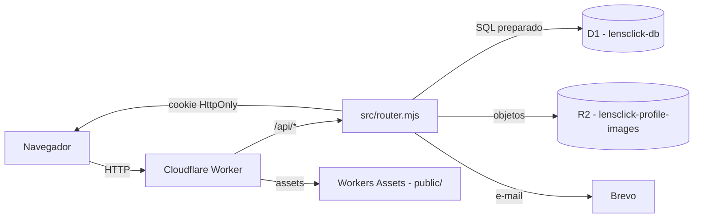

# CONTEXTO_PROJETO.md

> Documento permanente de onboarding para novos desenvolvedores e IAs.
> Última atualização: setembro de 2026.
>
> Consulte `docs/HANDOFF.md` para HEAD, branch e estado operacional atuais.

---

## 1. Visão geral do projeto

O **LensClick** é uma plataforma premium para fotógrafos, construída como uma aplicação **serverless** na Cloudflare. O objetivo é oferecer uma vitrine profissional, área autenticada de conta e perfil público de fotógrafo, com baixo custo operacional e alta confiabilidade.

- **URL oficial**: https://lensclick.renato-aparecido-business.workers.dev
- **Repositório**: monorepo único (frontend + backend + banco + infraestrutura).
- **Licença/uso**: privado, em evolução contínua.
- **Maturidade**: produto funcional com cadastro, login, recuperação de senha, central da conta, perfil profissional, portfolio, página pública de fotógrafo, busca, contato e newsletter.

---

## 2. Objetivo do LensClick

Conectar fotógrafos a clientes por meio de uma presença online profissional, sem a complexidade de um servidor tradicional. O fotógrafo cadastra-se, publica um perfil profissional com portfolio, e clientes podem encontrá-lo pela busca e visualizar seu trabalho.

O produto prioriza:

- **Experiência profissional** — interface premium, discreta e acessível.
- **Velocidade** — serverless com baixa latência.
- **Confiabilidade** — infraestrutura gerenciada pela Cloudflare.
- **Escalabilidade** — Workers, D1 e R2 escalam automaticamente.
- **Facilidade de uso** — fluxos curtos, feedback claro, bilíngue (PT/EN).

---

## 3. Tecnologias utilizadas

| Camada | Tecnologia |
|---|---|
| Frontend | HTML5, CSS3, JavaScript vanilla (sem framework) |
| Backend | Cloudflare Worker (`src/worker.mjs` — handlers e entrypoint; `src/router.mjs` — roteamento) |
| Banco de dados | Cloudflare D1 (SQLite serverless) |
| Armazenamento de imagens | Cloudflare R2 (bucket privado) |
| Assets estáticos | Cloudflare Workers Assets (`public/`) |
| E-mail transacional | Brevo (recuperação de senha) |
| Criptografia | Web Crypto API (PBKDF2-SHA-256, 100k iterações) |
| Dev tooling | Wrangler ^4.0.0, Node.js >=22.13.0 |
| Testes | Node.js test runner (`node --test`) — execute `npm test` para consultar o estado atual da suíte |
| CI/CD | GitHub Actions (workflow "Qualidade" + deploy automatizado) |
| Versionamento | Git (branch `main` protegida, fast-forward only) |

---

## 4. Arquitetura atual



### Princípios

- **Mesmo domínio** para frontend e API — simplifica cookies, origem e CORS.
- **Sem framework** no frontend — preserva a base original e reduz dependências.
- **R2 privado** — imagens nunca são públicas por URL direta; passam por autorização do Worker.
- **Migrações versionadas** — o banco nunca é editado manualmente em produção.
- **Imagens não são Base64 no D1** — cada serviço cumpre sua finalidade.

### Camadas

| Camada | Responsabilidade | Arquivo(s) |
|---|---|---|
| Interface | Páginas HTML | `public/*.html` |
| Design System | Tokens visuais | `DESIGN_SYSTEM.md`, `public/refinements.css` |
| i18n | Catálogos PT-BR/EN-US e runtime vanilla | `public/locales/*.json`, `public/lang.js` |
| UX | Feedback, loading, acessibilidade | `public/ux.js` |
| Perfil | Lógica da conta | `public/profile-api.js`, `public/photographer-profile.js`, `public/public-shell.js` |
| API | Roteamento, autenticação e validação | `src/router.mjs`, `src/worker.mjs` |
| Banco | Dados estruturados | `migrations/*.sql`, `db/schema.ts` |
| Objetos | Imagens (perfil + portfolio) | R2 binding `PROFILE_IMAGES` |
| Infra | Bindings e deploy | `wrangler.jsonc` |
| Qualidade | Testes e CI | `test/*.test.mjs`, `.github/workflows/quality.yml` |

---

## 5. Estrutura de pastas

```
LensClick/
├── .github/
│   ├── agents/              # 11 agentes Copilot (.agent.md)
│   ├── workflows/quality.yml
│   ├── workflows/deploy.yml
│   └── pull_request_template.md
├── .opencode/
│   └── agents/              # 12 agentes OpenCode (.md, mode: primary)
├── data/                    # D1 local (NÃO commitar)
├── db/schema.ts             # Catálogo TypeScript do schema (versão 14)
├── docs/
│   ├── DOCUMENTACAO_TECNICA.md   # Documentação técnica completa
│   └── CONTEXTO_PROJETO.md       # Este documento
├── migrations/             # Migrações SQL versionadas
│   ├── 0001_initial.sql ... 0010_monitor_minute_buckets.sql
│   ├── 0011_email_verification.sql
│   ├── 0012_admin_role.sql
│   ├── 0013_portfolio_cover_category.sql
│   └── 0014_sessions_kind.sql
├── public/                 # Frontend (assets estáticos)
│   ├── index.html          # Landing
│   ├── cadastro.html       # Cadastro
│   ├── login.html          # Login
│   ├── recuperar-senha.html # Solicitação de recuperação
│   ├── redefinir-senha.html # Nova senha
│   ├── perfil.html         # Central da conta
│   ├── fotografo.html      # Perfil profissional (edição)
│   ├── busca.html          # Busca de fotógrafos
│   ├── perfil_temp.html    # Redirecionamento legado
│   ├── privacidade.html    # Política
│   ├── termos.html         # Termos
│   ├── lang.js             # runtime i18n (window.i18n)
│   ├── locales/            # catálogos pt-BR.json e en-US.json
│   ├── ux.js               # Helpers UX (window.LensClickUX)
│   ├── profile-api.js      # Lógica da conta
│   ├── photographer-profile.js # Perfil profissional
│   ├── public-shell.js     # Shell público
│   ├── search.js           # Busca
│   ├── br-locations.js     # Estados/cidades BR
│   ├── refinements.css     # Design System
│   ├── account.css         # Estilos da conta
│   ├── photographer.css    # Estilos do fotógrafo
│   ├── search.css          # Estilos da busca
│   └── auth-recovery.css   # Estilos de recuperação
├── scripts/
│   ├── http-smoke.mjs      # Smoke test HTTP
│   ├── build_documentation.py
│   └── build_documentation_pdf.py
├── src/router.mjs          # Catálogo e despacho das rotas HTTP
├── src/worker.mjs          # Handlers e entrypoint do Worker
├── test/                   # 14 arquivos .test.mjs (suíte automatizada de testes)
├── tmp/                    # Arquivos temporários (PRs, rascunhos)
├── package.json
├── wrangler.jsonc          # Configuração Cloudflare
├── README.md
├── CONTRIBUTING.md
├── DESIGN_SYSTEM.md
└── CLOUDFLARE_SETUP.md
```

---

## 6. Convenções do projeto

### Código

- **Sem framework** no frontend — HTML/CSS/JS vanilla.
- **Sem ponto e vírgula** obrigatório (estilo do `worker.mjs` e scripts `public/`).
- **Nomes de função** em camelCase (`cleanText`, `normalizeEmail`, `slugify`).
- **Constantes** em UPPER_SNAKE_CASE (`SESSION_TTL_MS`, `MAX_BODY_BYTES`).
- **SQL preparado** com `.bind(...)` — nunca concatenação de strings.
- **Sem segredos no código** — usar `wrangler secret put` para chaves/tokens.

### Commits

- Curtos, explicando o **resultado** (não a implementação).
- Prefixos comuns: `feat:`, `fix:`, `docs:`, `chore:`, `refactor:`.

### Branches

- Nomes curtos e descritivos: `feature/recuperacao-de-senha`, `fix/traducao-do-rodape`, `docs/atualiza-arquitetura`.
- Escopo único por branch.
- `main` é protegida: fast-forward only, sem merge commits, `enforce_admins` ativo.

### Arquivos proibidos em commit

`.env`, `.dev.vars`, bancos de dados (`data/*.sqlite*`), tokens, senhas, `node_modules/`, `.wrangler/`, `dist/`.

---

## 7. Fluxo Git/GitHub

### Workflow padrão (6 passos)

1. Atualizar `main` (`git pull --ff-only origin main`).
2. Criar branch curta e descritiva a partir de `main`.
3. Manter escopo único na branch.
4. Validar localmente: `npm test` e `npm run check`.
5. Enviar branch e abrir Pull Request.
6. Aguardar validação automática (CI) e revisão.

### Pull Request

O PR deve explicar (template em `.github/pull_request_template.md`):

- **O que mudou**.
- **Por que a mudança é necessária**.
- **Como foi validado** (checkboxes: `npm test`, `npm run check`, revisar PT/EN, confirmar ausência de segredos/dados pessoais).
- **Evidências e observações**.

### CI (`.github/workflows/quality.yml`)

Workflow "Qualidade" dispara em `pull_request` e `push` para `main`:

- `npm ci` → `npm test` → `npm run check`.
- Cancela execuções anteriores da mesma ref (`concurrency`).
- Timeout de 10 minutos.

### Proteção de `main`

- `enforce_admins` ativo (regras valem para todos).
- Fast-forward only (sem merge commits).
- Requer CI verde.

---

## 8. Agentes existentes e responsabilidades

O projeto possui **11 agentes Copilot** em `.github/agents/*.agent.md`. Cada um tem frontmatter (`name`, `description`, `argumentHint`) e processo obrigatório em fases (Análise → Planejamento → Implementação → Revisão → Validação).

A partir do PR #134, os mesmos agentes foram portados para o OpenCode em `.opencode/agents/*.md` (12 arquivos: os 11 portados + o `explore`). O conteúdo dos prompts foi preservado integralmente entre as duas plataformas.

Todos os 12 agentes OpenCode usam `mode: all`, o que os torna **selecionáveis como agente principal** no seletor do chat **e** disponíveis para **delegação via subagente** — exigência das seções "Integração com outros agentes" de cada prompt. O `explore` do projeto substitui o `explore` nativo do OpenCode com um prompt mais rico, preservando o papel de subagente de busca e leitura.

O arquivo `.opencode/opencode.json` define `default_agent: "arquiteto-de-software"`: novas sessões do projeto já abrem com o coordenador técnico, porque o cliente desktop não expõe seletor de agentes.

### Como selecionar um agente

| Interface | Comando | Observação |
|---|---|---|
| TUI (terminal) | `Ctrl+X` e depois `A` | Abre a lista de agentes; `Shift+Tab` alterna entre eles |
| TUI (terminal) | `Ctrl+X` e depois `M` | Lista de modelos; `Ctrl+T` alterna variantes |
| CLI (`opencode run`) | `--agent <id>` | Ex.: `opencode run --agent especialista-em-seguranca "audite as rotas de admin"` |
| App desktop / cliente web | — | Não há seletor de agentes no composer (v2.1.1); usa o `default_agent` do projeto |

O `id` de cada agente é o nome do arquivo em `.opencode/agents/`, em kebab-case (`arquiteto-de-software`, `especialista-em-seguranca`, `revisor-de-codigo`, `explore`, e assim por diante).

| Agente | Responsabilidade |
|---|---|
| **Arquiteto de Software** | Decisões técnicas, arquitetura, escalabilidade, segurança, qualidade de longo prazo |
| **Designer** | Experiências web premium, layouts, acessibilidade, responsividade, identidade visual |
| **Engenheiro Backend** | Regras de negócio, APIs, autenticação, banco, integrações, segurança, escalabilidade |
| **Engenheiro de Banco de Dados** | Modelagem, otimização, integridade, migrações, performance de consultas |
| **Engenheiro DevOps** | Infraestrutura, automação, CI/CD, Cloudflare, GitHub, monitoramento, deploys |
| **Engenheiro de QA** | Validação, defeitos, regressões, fluxos completos, estabilidade |
| **Engenheiro Frontend** | Interface, UX, acessibilidade, responsividade, performance, implementação visual |
| **Especialista em Marketing para Fotografia** | Posicionamento, comunicação, experiência comercial, proposta de valor, conversão |
| **Especialista em Segurança** | Vulnerabilidades, proteção de dados, autenticação/autorização, APIs, sessões, infra |
| **Especialista em SEO e Performance** | SEO técnico, velocidade, Core Web Vitals, acessibilidade, indexação |
| **Revisor de Código** | Qualidade, legibilidade, boas práticas, arquitetura, manutenibilidade, consistência |

---

## 9. Roadmap técnico resumido

Baseado na seção 15 de `docs/DOCUMENTACAO_TECNICA.md`:

### Prioridade alta

- Busca real por cidade, especialidade, preço e disponibilidade.
- Verificação de e-mail.
- Capa destacada e categorias internas para o portfolio.
- Exportação de dados pelo usuário.
- Painel administrativo protegido por papel real.
- Revisão jurídica da política e dos termos.

### Prioridade média

- Domínio personalizado.
- Alertas e SLOs sobre a observabilidade estruturada.
- Cache adicional para reduzir leituras R2.
- Separação progressiva dos scripts inline da página inicial.
- Testes de interface em navegador e dispositivos reais.

### Próximo ciclo — aplicativo Android

- Agendamento e acompanhamento de orçamentos.
- Galerias privadas.
- Notificações.
- O aplicativo Android nativo em Kotlin já foi desenvolvido no Android Studio, mas seu código ainda está fora deste repositório e precisa ser disponibilizado, versionado e auditado.
- A Fase 6 incorpora o projeto, cria a matriz de paridade web/API/Android, define autenticação móvel, implementa o 2FA multicliente projetado no ADR 002, valida o release e prepara a publicação Google Play.
- O plano e os gates estão em `docs/PLANO_ANDROID_VALIDACAO_PUBLICACAO.md`.

---

## 10. Decisões arquiteturais já tomadas

1. **D1 para dados + R2 para imagens** — imagens não são Base64 no banco; cada serviço cumpre sua finalidade.
2. **Mesmo domínio para frontend e API** — simplifica cookies, origem e deploy; rotas relativas como `/api/auth/me`.
3. **HTML/CSS/JS sem framework** — preserva a base original e reduz dependências; maior responsabilidade manual na organização.
4. **Migrações versionadas** — `0001` a `0013`; mudanças futuras criam novos arquivos, nunca editam banco publicado.
5. **R2 privado** — privacidade tem prioridade sobre URL pública; foto privada passa por autorização do Worker.
6. **PBKDF2-SHA-256 com 100k iterações** — maior valor aceito pelo Web Crypto do Workers; 120k foi rejeitado em produção.
7. **Cookie HttpOnly/Secure/SameSite=Lax** — JavaScript da página não lê o cookie de sessão; TTL de 7 dias e máximo de cinco sessões ativas por usuário.
8. **i18n por chaves, preferência em localStorage** — PT é origem, EN por chaves; dados de conta nunca ficam em `localStorage`.
9. **Rate limit simples no D1** — tabela `rate_limits` com bucket e expiração; suficiente para o volume atual.
10. **Papéis `client`/`photographer` são dados de perfil**; autorização administrativa usa `users.is_admin` e `requireAdmin`, sem endpoint público de promoção.

---

## 11. Dependências importantes

### Runtime (produção)

| Dependência | Papel |
|---|---|
| Cloudflare Workers | Execução do backend |
| Cloudflare D1 | Banco de dados SQL |
| Cloudflare R2 | Armazenamento de imagens |
| Cloudflare Workers Assets | Servir `public/` |
| Brevo | E-mail transacional (recuperação, verificação e alertas) |
| Web Crypto API | Hash de senha e tokens |

### Desenvolvimento (`package.json`)

| Dependência | Versão | Papel |
|---|---|---|
| `wrangler` | ^4.0.0 | CLI da Cloudflare (dev, deploy, migrations) |

> Única `devDependency`. Não há dependências de runtime no `package.json` — tudo roda na Cloudflare.

A cadeia transitiva do `wrangler` (`miniflare` → `undici` + `sharp` + `workerd`) é **toolchain de desenvolvimento**: não entra no bundle publicado, e o bundle gerado pela versão 4.118.0 e pela 4.151.3 é byte-idêntico (SHA-256 `FAF38EFE2E887E206FD62F3E0430C757786B3387555E62F8FE325C49DB538575`). A política de atualização, a avaliação de risco e o gate `npm audit` no CI estão em `docs/DEPENDENCIAS_E_SEGURANCA.md`.

### Variáveis de ambiente (segredos)

| Variável | Onde definir | Obrigatória |
|---|---|---|
| `BREVO_API_KEY` | `wrangler secret put` | Para recuperação de senha |
| `BREVO_SENDER_EMAIL` | `wrangler secret put` | Para recuperação de senha |
| `BREVO_SENDER_NAME` | `wrangler secret put` | Opcional (padrão: `LensClick`) |

> **Nunca** colocar segredos em `wrangler.jsonc`, GitHub, `public/` ou qualquer arquivo versionado.

---

## 12. Padrões de código

### Backend (`src/router.mjs` e `src/worker.mjs`)

- **Funções puras** para validação/normalização (`cleanText`, `normalizeEmail`, `isValidEmail`, `isValidPassword`, `slugify`).
- **Statements preparados** com `.bind(...)` para todo SQL.
- **Constantes no topo** (`SESSION_TTL_MS`, `MAX_BODY_BYTES`, `MAX_PORTFOLIO_ITEMS`, etc.).
- **Roteador declarativo**: `src/router.mjs` resolve método/caminho, parâmetros dinâmicos, política de origem e separação entre API e assets.
- **Handlers preservados**: `dispatchApiRoute` em `src/worker.mjs` executa as regras existentes; a modularização por domínio pertence à Fase 4.
- **Respostas JSON** via helper `json()` com headers de segurança.
- **Escape HTML** (`escapeHtml`) para qualquer conteúdo exibido.
- **Rate limiting** via `consumeRateLimit` / `isRateLimited`.
- **Sessões**: token aleatório → hash SHA-256 → cookie HttpOnly.

### Frontend (`public/`)

- **Sem framework** — manipulação direta do DOM.
- **Helpers reutilizáveis** em `ux.js` (`window.LensClickUX`): `apiFetch`, `setBusy`, `showMessage`, `highlight`, `prefersReducedMotion`, `safeNextDestination`, `updateAccessibilityLabels`.
- **i18n** em `lang.js` (`window.i18n`): chaves `data-i18n` no HTML e catálogos JSON separados em `public/locales/`, com fallback progressivo para o português do HTML.
- **Sem dados de conta em `localStorage`** — apenas preferência de idioma.
- **Acessibilidade**: semântica (`header`/`nav`/`main`), `aria-live`, `aria-busy`, `aria-invalid`, foco visível, `prefers-reduced-motion`.
- **Design System**: tokens em `refinements.css` (prefixo `--lc-*`), aliases temporários (`--accent-1`, `--text`) para compatibilidade.

### Banco de dados

- **Migrações versionadas** em `migrations/NNNN_nome.sql`.
- **PRAGMA foreign_keys=ON**.
- **Índices** para consultas frequentes (`idx_sessions_user_id`, `idx_published_location`, `idx_slug`, `idx_user_position`).
- **CASCADE** em FKs de `sessions`, `password_reset_tokens`, `professional_profiles`, `portfolio_items`.

---

## 13. Estado atual do projeto

### Branch `main`

- Consulte `docs/HANDOFF.md` para HEAD, branch e estado operacional atuais.
- CI ativo (workflow "Qualidade").

### Funcionalidades em produção

- Landing page (index.html)
- Cadastro e login
- Recuperação de senha (via Brevo)
- Central autenticada da conta (perfil.html)
- Edição de perfil + foto (R2)
- Troca de senha com revogação de sessões
- Exclusão definitiva da conta
- Perfil profissional (rascunho/publicação, contatos seletivos) com onboarding guiado
- Portfolio profissional (upload R2, ordem, textos, até 12 itens) com galeria responsiva e variantes on-demand
- Página pública do fotógrafo, indexável (SSR, canonical, Open Graph e JSON-LD)
- Busca de fotógrafos com filtros de preço, raio e ordenação
- Avaliações e reputação verificadas
- Mensagens internas entre cliente e fotógrafo
- Contato e newsletter
- Sitemap.xml e robots.txt dinâmicos
- Cache de edge para leituras públicas
- Observabilidade estruturada, SLOs e alertas in-worker (disponibilidade, P95 e taxa de 5xx)
- Bilíngue PT/EN

### Branches, PRs e estado Git

O estado atual de branches, branches órfãs, PRs e pendências Git é mantido em `docs/HANDOFF.md`. Este documento permanente não duplica essa informação volátil.

### Débitos técnicos conhecidos

1. **Hotspots de conflito** — os catálogos em `public/locales/` concentram alterações frequentes. `src/worker.mjs` segue como ponto de composição, mas os handlers de domínio foram extraídos na Fase 4.2, reduzindo conflitos.
2. **Sem 2FA** — a verificação de e-mail existe em modo de aviso, mas o segundo fator ainda não foi implementado; foi **projetado** no ADR 002 (`docs/ADR_002_AUTENTICACAO_EM_DUAS_ETAPAS.md`, status Proposto: TOTP + códigos de recuperação), e a implementação está prevista para a Fase 6, web e Android.
3. **Android fora da fonte de verdade** — o projeto Kotlin existe, mas ainda precisa ser incorporado ao Git e auditado quanto a arquitetura, segurança, paridade e publicação.
4. **Rate limit híbrido** — escudo de rajada nativo na edge (PR #30) combinado a políticas longas no D1; atende o volume atual.
5. **Termos/política precisam de revisão jurídica** — divulgações LGPD de alta prioridade (PR #89), de média prioridade (PR #91) e cláusulas opcionais (PR #93) já publicadas; resta a revisão legal formal antes do uso comercial. Iniciativa 5.5.
6. **Papéis não autorizam áreas** — `client`/`photographer` continuam sendo dados de perfil; a autorização administrativa agora usa `is_admin` + `requireAdmin` (5.4.b/c).
7. **Aliases visuais legados** — os aliases principais foram migrados para `--lc-*` na 5.7; aliases residuais permanecem documentados como dívida técnica.
---

## 14. Próximos passos imediatos

### Encerramento da Fase 5 e início da Fase 6

O plano de limpeza e consolidação P0-P4 registrado em versões anteriores foi **integralmente concluído**: todas as branches citadas já estavam integradas e as duas últimas remotas pendentes foram removidas em 3 de setembro de 2026.

Na Fase 5, restam a revisão jurídica formal (5.5.b) e domínio/DNS/e-mail (5.8.c). Ambos passam a ser gates de lançamento da Fase 6, sem perder seu histórico:

| Ordem | Iniciativa | Complexidade |
|---:|---|:---:|
| 17 | 5.1 Consolidação documental — concluída | Baixa |
| 18 | 5.2 Backup e restauração do D1 — concluída | Média |
| 19 | 5.3 Endurecimento transversal de segurança — concluída | Média |
| 20 | 5.4 Verificação de e-mail e papéis de autorização — concluída | Alta |
| 21 | 5.5 Portabilidade LGPD — parcial; revisão jurídica pendente | Baixa |
| 22 | 5.6 Automação da entrega — concluída | Média |
| 23 | 5.7 Qualidade e débitos técnicos — concluída | Média |
| 24 | 5.8 Produto e presença — parcial; domínio/e-mail pendentes | Média |

A sequência atual é a **Fase 6**, detalhada em `docs/PLANO_ANDROID_VALIDACAO_PUBLICACAO.md`: incorporar o projeto Kotlin; auditar paridade; definir contrato móvel; implementar diferenças; implementar o 2FA projetado no ADR 002 (Proposto); validar web/API/Android; concluir domínio e jurídico; publicar por faixas na Google Play.

### Estado de `db/schema.ts`

- `schemaVersion=14`, com as 16 tabelas das migrações `0001`-`0014`.
- As migrações permanecem como fonte executável; o catálogo TypeScript deve acompanhar novas migrações no mesmo PR. A invariante é verificada automaticamente: o teste `o catalogo db/schema.ts esta em sintonia com as migrations publicadas` falha se `schemaVersion` divergir da quantidade de arquivos em `migrations/` ou se a última migration não tiver o prefixo correspondente.

### Antes de qualquer alteração

- Rodar `npm test` (suíte automatizada) e `npm run check` (dry-run de deploy).
- Confirmar que `main` está atualizada (`git pull --ff-only origin main`).
- Criar branch de escopo único.

---

## Como iniciar uma nova conversa com IA

> **Leia estes documentos antes de qualquer alteração no código.**

### Leitura obrigatória (ordem recomendada)

1. **`docs/AI_CONTEXT.md`** — guia operacional para IAs: regras, fontes de verdade, procedimentos antes/depois de alterar, hotspots e o que não fazer.
2. **`docs/CONTEXTO_PROJETO.md`** (este documento) — visão geral, arquitetura, convenções, débitos técnicos e próximos passos.
3. **`docs/HANDOFF.md`** — estado operacional atual (HEAD, branches, PRs, pendências e tarefas prioritárias). Mutável; validar contra Git quando necessário.
4. **`docs/DECISOES_TECNICAS.md`** — registro das 17 decisões arquiteturais já tomadas, com motivo, alternativas e consequências.
5. **`README.md`** — produto, requisitos, execução local, verificações, escopo atual.
6. **`CONTRIBUTING.md`** — fluxo Git/GitHub de 6 passos, regras de branch e PR.
7. **`docs/DOCUMENTACAO_TECNICA.md`** — documentação técnica completa (arquitetura, endpoints, modelo de dados, segurança, testes, deploy).
8. **`docs/ROADMAP_EVOLUCAO.md`** — documento vivo: Fases 1 a 4 concluídas e Fase 5 em execução. **Não confundir intenção futura com implementação.**
9. **`DESIGN_SYSTEM.md`** — tokens visuais, componentes, direção visual.
10. **`CLOUDFLARE_SETUP.md`** — procedimentos de deploy, segredos, conferência pós-publicar.
11. **`wrangler.jsonc`** — bindings (D1 `DB`, R2 `PROFILE_IMAGES`, Assets `ASSETS`), configuração do Worker.
12. **`package.json`** — scripts (`start`, `dev`, `test`, `check`, `test:smoke`, `db:migrate:*`), engines.
13. **`.github/agents/`** — 11 agentes Copilot e suas responsabilidades.
14. **`.opencode/agents/`** — os mesmos 11 agentes portados para o OpenCode, mais o `explore` (12 no total), com `mode: primary`.
15. **`docs/ADR_002_AUTENTICACAO_EM_DUAS_ETAPAS.md`** — decisão de 2FA (status Proposto): threat model, comparação de opções e contratos previstos, sem implementação iniciada.

### Leitura contextual (conforme a tarefa)

| Tarefa | Ler também |
|---|---|
| Alterar API/backend | `src/router.mjs`, `src/worker.mjs`, `migrations/*.sql` |
| Alterar banco de dados | `migrations/*.sql`, `db/schema.ts` |
| Alterar frontend | `public/*.html`, `public/*.js`, `public/*.css` |
| Alterar UX/acessibilidade | `public/ux.js`, `public/lang.js`, `public/locales/*.json`, `DESIGN_SYSTEM.md` |
| Alterar infra/CI/CD | `wrangler.jsonc`, `.github/workflows/quality.yml`, `CLOUDFLARE_SETUP.md` |
| Adicionar testes | `test/*.test.mjs`, `scripts/http-smoke.mjs` |
| Segurança | `src/worker.mjs` (funções de hash/sessão), `CLOUDFLARE_SETUP.md` (segredos) |

### Comandos essenciais

```bash
npm install              # Instalar dependências
npm start                # Migrar D1 local + iniciar na porta 4174
npm test                 # Executar a suíte automatizada de testes
npm run check            # Simular pacote de deploy (dry-run)
npm run test:smoke       # Smoke test HTTP (requer servidor local ativo)
npm run db:migrate:remote # Aplicar migrações no D1 remoto
npx wrangler deploy      # Publicar na Cloudflare
```

> **Ambiente local no disco D:** o toolchain do projeto (Node portable, cache do npm, Playwright, temporários, logs do wrangler e dados do OpenCode) é mantido no HDD, sem escrita no SSD. A configuração é idempotente e versionada em `scripts/env-local.ps1`; os detalhes e a ordem de migração estão em `docs/HANDOFF.md`, seção "Ambiente (Windows)". No PowerShell, use `npm.cmd` — o `npm.ps1` é bloqueado pela ExecutionPolicy.


### Regras de ouro

1. **Nunca altere código sem entender a consequência.**
2. **Nunca commitar segredos** (`BREVO_API_KEY`, `.dev.vars`, senhas, tokens).
3. **Nunca editar migrações já publicadas** — crie uma nova `0005_*.sql`.
4. **Sempre rode `npm test` e `npm run check` antes de commitar.**
5. **Sempre crie branch de escopo único a partir de `main` atualizada.**
6. **`main` é fast-forward only** — sem merge commits.
7. **Imagens passam pelo Worker, não por URL pública do R2.**
8. **SQL sempre preparado com `.bind(...)`** — nunca concatenação.
9. **Dados de conta nunca em `localStorage`** — apenas preferência de idioma.
10. **PT-BR é o idioma de origem** — PT-BR e EN-US mantêm o mesmo contrato de chaves nos catálogos.

## Documentação complementar

Além deste documento, o projeto possui documentos especializados:

- `docs/HANDOFF.md`
  - Estado atual do projeto.
  - Situação do repositório.
  - Pendências e próximos passos.

- `docs/DECISOES_TECNICAS.md`
  - Registro das decisões arquiteturais já tomadas.
  - Motivos técnicos e consequências.

- `docs/AI_CONTEXT.md`
  - Contexto específico para agentes de IA trabalharem no projeto.
