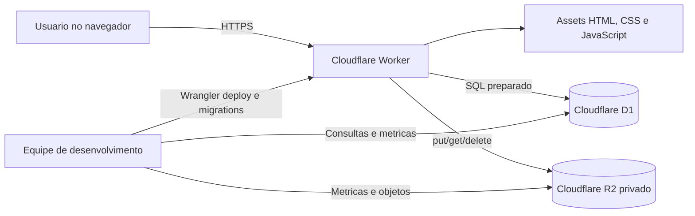
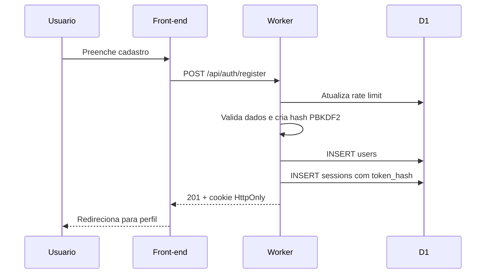
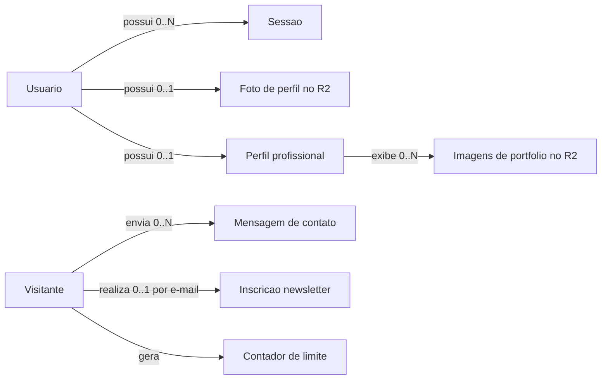
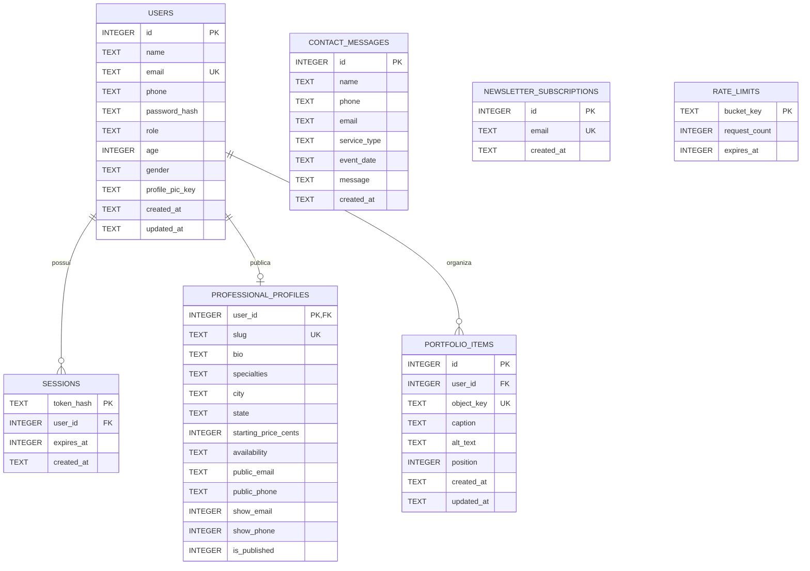
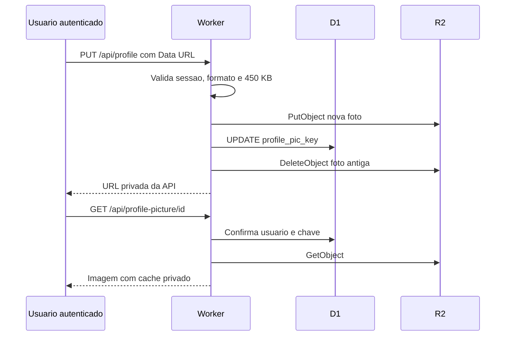
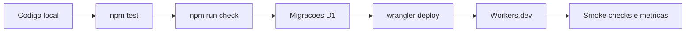

# LensClick - Documentação Tecnica do Sistema

**Fase 9 - Preparação para apresentação técnica**  
**Versao documentada:** 1.0.0  
**Data de referencia:** 2 de agosto de 2026  
**Ambiente oficial:** <https://lensclick.renato-aparecido-business.workers.dev>

> Este manual explica o produto, a arquitetura, o código, o banco de dados, a segurança, os testes, a operação em nuvem e os principais pontos de apresentação. Ele descreve a implementação existente; itens futuros aparecem explicitamente como evolução, não como funcionalidade pronta.

## 1. Visão executiva

LensClick e uma aplicacao web responsiva para apresentacao e contratacao de servicos fotograficos. O produto combina uma landing page institucional com cadastro, login, perfil autenticado, formulario de contato e newsletter.

A aplicacao utiliza uma arquitetura serverless na Cloudflare:

- o navegador recebe HTML, CSS e JavaScript estaticos;
- o Cloudflare Worker atende os arquivos e executa a API;
- o Cloudflare D1 guarda dados estruturados;
- o Cloudflare R2 guarda fotos de perfil e imagens de portfolio privadas;
- o mesmo dominio atende o front-end e a API, reduzindo complexidade de CORS e cookies;
- o Wrangler executa, testa, migra e publica o projeto.

### 1.1 O que ja funciona

- Site institucional em portugues e ingles.
- Layout responsivo e navegacao por secoes.
- Carrossel, portfolio filtravel, modais, FAQ e formularios.
- Cadastro com senha protegida por hash.
- Login, sessao persistente e logout.
- Recuperacao de senha com token temporario e envio pela Brevo.
- Central autenticada com edicao de dados e confirmacao da senha para trocar o e-mail.
- Troca de senha com encerramento das outras sessoes.
- Foto privada de perfil em JPG, PNG ou WebP, limitada a 450 KB.
- Portfolio profissional com ate 12 imagens no R2, descricoes acessiveis, legendas e ordenacao.
- Remocao permanente da foto no R2 pelo proprio usuario.
- Exclusao definitiva da conta, sessoes, tokens, foto privada e portfolio.
- Perfil profissional em rascunho ou publicado, com contatos controlados individualmente.
- Pagina publica do fotografo com apresentacao, especialidades, localizacao, preco inicial e disponibilidade.
- Mensagens de contato persistidas.
- Inscricoes de newsletter persistidas e sem duplicacao por e-mail.
- Protecao de origem, limite de tentativas e cabecalhos de seguranca.
- Testes automatizados e validacao de publicacao.
- Implantacao oficial no Cloudflare Workers com D1 e R2.

### 1.2 O que ainda nao existe

- Painel administrativo.
- Verificacao de e-mail.
- Agendamentos, pagamentos ou galerias de entrega.
- Aplicativo Android nativo.
- Dominio personalizado.

## 2. Explicacao do sistema em cinco minutos

1. **Problema:** clientes precisam conhecer os servicos, avaliar o portfolio e iniciar contato com a equipe de fotografia.
2. **Solucao:** a LensClick concentra apresentacao, orcamento, cadastro e perfil em uma experiencia responsiva e bilingue.
3. **Front-end:** paginas HTML com CSS e JavaScript, apoiadas por camadas compartilhadas de traducao, UX e Design System.
4. **Back-end:** um Cloudflare Worker recebe as requisicoes, valida entradas, autentica usuarios e acessa os servicos de dados.
5. **Persistencia:** D1 guarda usuarios, sessoes, contatos, newsletter e limites contra abuso; R2 guarda fotos de perfil e portfolio.
6. **Seguranca:** senhas nunca sao armazenadas em texto puro; sessoes usam cookies HttpOnly; imagens exigem autenticacao.
7. **Qualidade:** 54 testes verificam o fluxo principal, os scripts, a acessibilidade, a documentacao, a traducao e a integridade dos links.
8. **Operacao:** o projeto e publicado pelo Wrangler e monitorado no painel da Cloudflare.

## 3. Arquitetura

### 3.1 Diagrama de contexto



### 3.2 Responsabilidade de cada camada

| Camada | Responsabilidade | Arquivos ou servicos |
|---|---|---|
| Interface | Conteudo, formularios, navegacao e estados visuais | `public/*.html` |
| Design System | Tokens, componentes, foco, movimento e responsividade | `public/refinements.css` |
| Internacionalizacao | Portugues, ingles e transicao de idioma | `public/lang.js` |
| UX compartilhada | Requisicoes, feedback, loading e validacao | `public/ux.js` |
| Perfil | Carregamento, edicao, imagem e logout | `public/profile-api.js` |
| API e seguranca | Rotas, validacoes, autenticacao e cabecalhos | `src/worker.mjs` |
| Banco relacional | Usuarios, sessoes, contatos, newsletter e rate limit | Cloudflare D1 |
| Objetos | Imagens privadas de perfil e portfolio | Cloudflare R2 |
| Infraestrutura | Bindings, assets, migracoes e publicacao | `wrangler.jsonc` |
| Qualidade | Testes unitarios, integrados e smoke test | `test/` e `scripts/` |

### 3.3 Por que serverless

- Nao ha servidor dedicado para administrar.
- O Worker escala conforme as requisicoes.
- D1 e R2 sao acessados por bindings internos.
- O site e a API sao publicados juntos.
- A franquia gratuita atende com folga o uso inicial.
- O custo e o consumo podem ser acompanhados pelo painel.

## 4. Estrutura do repositorio

```text
LensClick/
|-- public/                    # Paginas e arquivos entregues ao navegador
|   |-- index.html             # Landing page
|   |-- cadastro.html          # Criacao de conta
|   |-- login.html             # Autenticacao
|   |-- perfil.html            # Area autenticada
|   |-- fotografo.html         # Perfil profissional publico
|   |-- perfil_temp.html       # Redirecionamento legado seguro
|   |-- recuperar-senha.html   # Solicitacao de recuperacao
|   |-- redefinir-senha.html   # Confirmacao da nova senha
|   |-- privacidade.html       # Politica de privacidade
|   |-- termos.html            # Termos de uso
|   |-- lang.js                # Dicionario PT/EN e animacao
|   |-- ux.js                  # Comportamentos compartilhados
|   |-- profile-api.js         # Integracao da tela de perfil
|   |-- photographer-profile.js # Renderizacao segura do perfil publico
|   |-- account.css            # Layout da central da conta
|   `-- refinements.css        # Design System e refinamentos
|-- src/worker.mjs             # Back-end e entrega de assets
|-- migrations/0001_initial.sql# Esquema executavel do D1
|-- migrations/0002_password_reset.sql # Tokens de recuperacao
|-- migrations/0003_professional_profiles.sql # Perfil profissional
|-- migrations/0004_portfolio_items.sql # Portfolio profissional
|-- db/schema.ts               # Referencia da versao do esquema
|-- scripts/http-smoke.mjs     # Teste HTTP ponta a ponta
|-- test/                      # Suite automatizada
|-- wrangler.jsonc             # Configuracao Cloudflare
|-- package.json               # Scripts e dependencias
|-- README.md                  # Inicio rapido
|-- DESIGN_SYSTEM.md           # Regras visuais
`-- docs/                      # Documentacao da Fase 9
```

## 5. Front-end

### 5.1 Pagina inicial - `public/index.html`

A pagina inicial concentra a experiencia institucional. Ela possui:

- cabecalho responsivo com links e autenticacao;
- navegacao lateral por indicadores de secao;
- carrossel de destaques com rotacao automatica e controles acessiveis;
- historia, numeros e fotografia institucional;
- cards de servicos e direcionamento para orcamento;
- portfolio com filtros e ampliacao em modal;
- formulario de contato, informacoes e newsletter em abas;
- avaliacoes e perguntas frequentes;
- rodape com redes sociais, termos e privacidade.

O JavaScript inline coordena componentes especificos da pagina. Os comportamentos reutilizaveis permanecem nos arquivos compartilhados.

### 5.2 Cadastro - `public/cadastro.html`

O formulario coleta nome, e-mail, telefone, senha, confirmacao e consentimento. Antes do envio:

- o HTML aplica validacoes nativas;
- o JavaScript confirma se as senhas coincidem;
- o botao entra em estado de carregamento;
- a API recebe apenas os campos necessarios;
- sucesso redireciona para `perfil.html`;
- erros da API sao apresentados em regiao acessivel.

### 5.3 Login - `public/login.html`

Envia e-mail e senha para `/api/auth/login`. Quando o login funciona, o cookie de sessao e recebido automaticamente e o usuario segue para um destino local validado. A funcao `safeNextDestination` evita redirecionamentos para dominios externos.

### 5.4 Perfil - `public/perfil.html` e `public/profile-api.js`

Ao abrir a pagina, `loadProfile` consulta `/api/auth/me`. Se a sessao nao existir, o navegador volta ao login. O usuario pode alterar nome, e-mail, telefone, papel, idade, genero e foto. A troca de e-mail exige a senha atual. A area de seguranca permite criar outra senha e encerra as sessoes abertas em outros dispositivos, preservando apenas a sessao usada na alteracao. A foto pode ser removida permanentemente do R2 por uma acao explicita com confirmacao.

A zona de perigo permite excluir definitivamente a conta. O usuario precisa informar a senha atual e digitar `EXCLUIR` ou `DELETE`, conforme o idioma. O Worker remove primeiro a foto privada e, depois, executa uma transacao no D1 que elimina tokens de recuperacao, sessoes e usuario. Ao concluir, o cookie de sessao e expirado e a interface retorna ao login. Mensagens de contato e newsletter nao sao removidas por simples coincidencia de e-mail enquanto o cadastro nao possui verificacao de titularidade; esses registros independentes seguem o canal de privacidade.

A imagem e validada duas vezes:

- no navegador, para feedback imediato;
- no Worker, que representa a barreira de seguranca real.

O arquivo precisa ser JPG, PNG ou WebP e ter no maximo 450 KB. O navegador converte a imagem para Data URL; o Worker decodifica, valida e grava os bytes no R2.

O fotografo tambem pode manter um perfil profissional em rascunho. A publicacao exige foto, apresentacao com pelo menos 60 caracteres, especialidade, cidade, estado e ao menos um contato profissional. E-mail e telefone possuem controles independentes de visibilidade. Remover a foto ou trocar o papel da conta para cliente despublica o perfil automaticamente.

A mesma area permite montar o portfolio profissional. Cada fotografo pode enviar ate 12 imagens JPG, PNG ou WebP, com limite de 4 MB por arquivo. Cada item exige descricao alternativa para acessibilidade, aceita legenda opcional e pode ser reordenado. As imagens ficam no R2, enquanto o D1 guarda apenas metadados, ordem e a chave privada do objeto.

### 5.5 Perfil profissional publico - `public/fotografo.html`

A pagina recebe o identificador pelo parametro `perfil`, consulta apenas registros publicados e renderiza todo conteudo fornecido pelo usuario com `textContent`. O Worker nao devolve e-mail ou telefone sem o consentimento especifico correspondente. Links externos aceitam apenas HTTP ou HTTPS e abrem com `noopener noreferrer`. A galeria publica usa rotas do Worker para entregar apenas imagens de portfolios vinculados a perfis publicados.

### 5.6 Traducao - `public/lang.js`

Os elementos traduziveis usam chaves como `data-i18n`, `data-i18n-placeholder`, `data-i18n-title`, `data-i18n-aria` e `data-i18n-section`.

O modulo:

- escolhe o idioma salvo ou o idioma do navegador;
- preserva os valores originais em portugues;
- aplica o dicionario em ingles;
- atualiza texto, HTML controlado, placeholders e rotulos;
- atualiza o ano do copyright;
- dispara `translations.updated` para outros componentes;
- executa a transicao vertical inspirada na versao antiga;
- respeita `prefers-reduced-motion`.

### 5.7 UX compartilhada - `public/ux.js`

`window.LensClickUX` expoe funcoes pequenas e reutilizaveis:

- `apiFetch`: chama a API, interpreta JSON e normaliza erros;
- `setBusy`: bloqueia botoes e mostra loading;
- `showMessage`: apresenta sucesso, erro ou informacao com ARIA;
- `highlight`: aplica destaque temporario;
- `prefersReducedMotion`: detecta preferencia de movimento;
- `safeNextDestination`: valida redirecionamento local;
- `updateAccessibilityLabels`: sincroniza rotulos PT/EN.

### 5.8 Design System - `public/refinements.css`

Os tokens iniciados por `--lc-` sao a fonte oficial para cores, tipografia, espacamento, raios, sombras, controles e movimento. Os nomes antigos permanecem como aliases para compatibilidade.

Principais decisoes:

- marca em roxo `#a35bff` e azul `#5bb3ff`;
- superficies escuras e texto de alto contraste;
- controles com altura minima de 48 px;
- escala de espacamento baseada em multiplos de 4 px;
- foco visivel;
- transicoes curtas com curva padrao;
- reducao de movimento quando solicitada pelo sistema;
- estados de loading, sucesso, erro, foco e desabilitado.

## 6. Back-end - `src/worker.mjs`

O Worker possui duas responsabilidades: atender `/api/*` e entregar os arquivos da pasta `public/`.

### 6.1 Constantes principais

| Constante | Valor | Finalidade |
|---|---:|---|
| `SESSION_COOKIE` | `lensclick_session` | Nome do cookie |
| `SESSION_TTL_MS` | 7 dias | Duracao da sessao |
| `MAX_BODY_BYTES` | 700.000 bytes | Limite do JSON recebido |
| `MAX_PROFILE_PICTURE_BYTES` | 450.000 bytes | Limite da foto |
| `PBKDF2_ITERATIONS` | 100.000 | Custo do hash compativel com Workers |

### 6.2 Funcoes de apoio

- `cleanText`: converte, remove espacos externos e limita tamanho.
- `normalizeEmail`: limpa e transforma o e-mail em minusculas.
- `isValidEmail`: verifica formato e tamanho.
- `bytesToBase64Url` e `base64UrlToBytes`: convertem dados binarios.
- `randomToken`: gera tokens com `crypto.getRandomValues`.
- `sha256`: gera o hash usado para proteger tokens de sessao.
- `hashPassword`: cria salt aleatorio e hash PBKDF2-SHA-256.
- `verifyPassword`: recalcula o hash e compara todos os bytes.
- `parseCookies`: interpreta cookies da requisicao.
- `sessionCookie`: cria ou expira o cookie de sessao.
- `responseHeaders`: aplica cabecalhos de seguranca.
- `json`: padroniza respostas JSON.
- `readJson`: limita o corpo e trata JSON invalido.
- `requestOriginIsAllowed`: permite escrita apenas pela mesma origem.
- `publicUser`: remove campos internos antes de responder.
- `authenticatedUser`: valida cookie e busca a sessao ativa.
- `createSession`: remove sessoes vencidas e cria uma nova.
- `isRateLimited`: contabiliza tentativas por escopo, IP e janela.
- `decodeProfilePicture`: valida formato, Base64, tamanho e MIME.
- `portfolioUpload`: valida multipart, MIME, tamanho e descricao alternativa das imagens do portfolio.
- `storedImageResponse`: padroniza resposta, cache e cabecalhos de imagens vindas do R2.
- `handleApi`: roteia e executa os endpoints.
- `handleRequest`: separa API de arquivos estaticos.

### 6.3 Endpoints

| Metodo | Rota | Autenticacao | Funcao | Respostas principais |
|---|---|---|---|---|
| POST | `/api/auth/register` | Nao | Criar usuario e sessao | 201, 400, 409, 429 |
| POST | `/api/auth/login` | Nao | Validar credenciais | 200, 401, 429 |
| POST | `/api/auth/password-reset/request` | Nao | Solicitar link de recuperacao | 202, 400, 429, 503 |
| POST | `/api/auth/password-reset/confirm` | Nao | Definir senha com token unico | 200, 400, 429 |
| POST | `/api/auth/logout` | Cookie | Encerrar sessao | 200 |
| GET | `/api/auth/me` | Cookie | Obter usuario atual | 200, 401 |
| GET | `/api/account/professional-profile` | Cookie | Obter rascunho profissional | 200, 401 |
| PUT | `/api/account/professional-profile` | Cookie + papel fotografo | Salvar ou publicar perfil profissional | 200, 400, 401, 403, 429 |
| GET | `/api/account/portfolio` | Cookie | Listar portfolio do proprio fotografo | 200, 401 |
| POST | `/api/account/portfolio` | Cookie + papel fotografo | Enviar imagem ao portfolio | 201, 400, 401, 403, 409, 413 |
| PUT | `/api/account/portfolio` | Cookie + papel fotografo | Atualizar ordem e textos do portfolio | 200, 400, 401, 403 |
| GET | `/api/account/portfolio/:id/image` | Cookie | Entregar imagem privada do portfolio | 200, 304, 404 |
| DELETE | `/api/account/portfolio/:id` | Cookie | Remover item e objeto do portfolio | 200, 401, 404 |
| GET | `/api/photographers/:slug` | Nao | Obter somente perfil publicado | 200, 404 |
| GET | `/api/photographers/:slug/photo` | Nao | Entregar foto de perfil publicado | 200, 304, 404 |
| GET | `/api/photographers/:slug/portfolio/:id` | Nao | Entregar imagem de portfolio publicado | 200, 304, 404 |
| PUT | `/api/profile` | Cookie | Atualizar perfil e foto; senha atual se o e-mail mudar | 200, 400, 401, 403, 409, 413 |
| PUT | `/api/account/password` | Cookie | Trocar senha e revogar outras sessoes | 200, 400, 401, 403, 409, 429 |
| DELETE | `/api/account/photo` | Cookie | Remover foto do D1 e R2 | 200, 401 |
| DELETE | `/api/account` | Cookie + senha | Excluir conta e dados vinculados | 200, 400, 401, 403, 429 |
| GET | `/api/profile-picture/:id` | Cookie | Entregar a propria foto | 200, 304, 404 |
| POST | `/api/contact` | Nao | Registrar mensagem | 201, 400, 429 |
| POST | `/api/newsletter` | Nao | Registrar e-mail | 201, 400, 429 |

### 6.4 Codigos HTTP

- `200`: operacao concluida.
- `201`: registro criado.
- `304`: imagem nao mudou e pode usar cache.
- `400`: dados invalidos.
- `401`: autenticacao ausente ou credencial incorreta.
- `403`: origem nao autorizada ou senha atual incorreta em operacao sensivel.
- `404`: endpoint, sessao visual ou imagem nao encontrados.
- `409`: conflito de e-mail.
- `413`: corpo ou foto acima do limite.
- `429`: excesso de tentativas.
- `500`: erro interno sem detalhes sensiveis para o usuario.

## 7. Autenticacao e sessao

### 7.1 Fluxo de cadastro



### 7.2 Como a senha e protegida

1. O Worker gera um salt aleatorio de 16 bytes.
2. PBKDF2-SHA-256 executa 100.000 iteracoes.
3. O banco recebe algoritmo, iteracoes, salt e hash.
4. A senha original deixa de ser necessaria e nunca e gravada.
5. No login, o processo e repetido com o salt salvo.
6. A comparacao percorre todos os bytes para reduzir variacao temporal.

Formato conceitual armazenado:

```text
pbkdf2-sha256$100000$<salt>$<hash>
```

### 7.3 Como a sessao funciona

- O navegador recebe um token aleatorio.
- O D1 recebe apenas `SHA-256(token)`.
- O cookie usa `HttpOnly`, impedindo leitura por JavaScript.
- Em HTTPS, o cookie recebe `Secure`.
- `SameSite=Lax` reduz envio em contextos entre sites.
- A validade e de sete dias.
- O logout remove a sessao e expira o cookie.

## 8. Modelo de dados

### 8.1 MER - Modelo Entidade-Relacionamento

O MER apresenta os conceitos do negocio. Usuario possui sessoes, pode ter uma foto externa e, quando fotografo, um perfil profissional e itens de portfolio. Mensagens de contato e inscricoes de newsletter sao registros independentes. Rate limit representa controle tecnico de abuso.



### 8.2 DER - Diagrama Entidade-Relacionamento



### 8.3 Dicionario de dados - `users`

| Campo | Tipo | Regra | Significado |
|---|---|---|---|
| `id` | INTEGER | PK, autoincremento | Identificador do usuario |
| `name` | TEXT | obrigatorio | Nome exibido |
| `email` | TEXT | obrigatorio, unico, case-insensitive | Login e contato |
| `phone` | TEXT | obrigatorio | Telefone informado |
| `password_hash` | TEXT | obrigatorio | Hash, nunca senha original |
| `role` | TEXT | `client` ou `photographer` | Papel declarado |
| `age` | INTEGER | opcional, 0 a 120 | Idade |
| `gender` | TEXT | `male`, `female` ou `other` | Genero declarado |
| `profile_pic_key` | TEXT | opcional | Chave privada no R2 |
| `created_at` | TEXT | automatico | Criacao |
| `updated_at` | TEXT | automatico/atualizado | Ultima alteracao |

### 8.4 Dicionario de dados - demais tabelas

**`sessions`**

- `token_hash`: chave primaria derivada do token do cookie.
- `user_id`: chave estrangeira para `users.id` com exclusao em cascata.
- `expires_at`: instante de expiracao em milissegundos Unix.
- `created_at`: data de criacao.

**`professional_profiles`**

- `user_id`: relacao unica com `users`, removida em cascata junto com a conta;
- `slug`: identificador publico estavel e unico;
- `specialties`: lista JSON limitada a categorias reconhecidas pelo Worker;
- `starting_price_cents`: valor monetario inteiro em centavos;
- `show_email`, `show_phone` e `is_published`: consentimentos independentes, desativados por padrao;
- `updated_at`: permite auditoria operacional e evolucao futura do cache.

**`portfolio_items`**

- `id`: identificador interno do item;
- `user_id`: relacao com `users.id`, removida em cascata com a conta;
- `object_key`: chave privada e unica do arquivo no R2;
- `caption`: legenda opcional exibida no perfil publico;
- `alt_text`: descricao obrigatoria para acessibilidade;
- `position`: ordem exibida na area da conta e na pagina publica;
- `created_at` e `updated_at`: controle operacional e cache de imagem.

**`contact_messages`**

- guarda nome, telefone opcional, e-mail, servico, data do evento, mensagem e criacao;
- indice em `created_at` facilita listagem cronologica.

**`newsletter_subscriptions`**

- e-mail unico com comparacao case-insensitive;
- repeticoes sao ignoradas pela API.

**`rate_limits`**

- `bucket_key` e um hash do escopo, IP e janela de tempo;
- `request_count` registra tentativas;
- `expires_at` permite limpeza de janelas antigas.

## 9. Armazenamento R2

O bucket `lensclick-profile-images` e privado e nunca expoe a chave real do objeto. Na area da conta, o Worker confirma que o ID solicitado pertence ao usuario autenticado. No perfil profissional, rotas publicas separadas liberam a foto e as imagens do portfolio somente enquanto o perfil estiver publicado e a conta mantiver o papel de fotografo.

### 9.1 Fluxo da foto e do portfolio



O portfolio usa o mesmo principio de privacidade. O upload chega como `multipart/form-data`, o Worker valida MIME, tamanho, papel do usuario, limite de 12 imagens e descricao alternativa. Depois grava o arquivo no R2 em `portfolio/<user_id>/<uuid>.<ext>` e registra metadados em `portfolio_items`. A exclusao remove primeiro o item do D1 e depois o objeto do R2; a exclusao definitiva da conta remove todos os objetos conhecidos.

### 9.2 Relacao com custos

- `PutObject` e operacao Classe A.
- `GetObject` e operacao Classe B.
- `DeleteObject` e gratuito no R2 Standard.
- O limite de 450 KB para foto e 4 MB por item de portfolio reduz armazenamento e transferencia.
- A troca remove o objeto antigo depois de atualizar o banco.

## 10. Seguranca

### 10.1 Controles implementados

- Hash PBKDF2-SHA-256 com salt individual.
- Token de sessao aleatorio e hash no banco.
- Cookie HttpOnly, SameSite e Secure em HTTPS.
- Validacao de origem nas operacoes de escrita.
- Consultas SQL preparadas e valores vinculados.
- Limite de tamanho do corpo JSON.
- Validacao no servidor, independente do navegador.
- Rate limit para cadastro, login, contato e newsletter.
- Foto privada e restrita ao proprio usuario.
- Mensagens de erro interno sem stack trace para o cliente.
- `Content-Security-Policy`.
- `X-Content-Type-Options: nosniff`.
- `X-Frame-Options: DENY`.
- `Referrer-Policy: strict-origin-when-cross-origin`.
- `Permissions-Policy` sem camera, microfone e geolocalizacao.

### 10.2 Limites conhecidos de seguranca

- Nao existe segundo fator de autenticacao.
- Nao existe verificacao de e-mail.
- O rate limit e simples e armazenado no D1.
- Termos e politica precisam de revisao institucional antes de uso comercial.
- Papeis `client` e `photographer` sao dados de perfil; ainda nao autorizam areas diferentes.

## 11. Acessibilidade, UX e internacionalizacao

### 11.1 Acessibilidade

- Estrutura semantica com `header`, `nav`, `main`, secoes e rodape.
- Rotulos associados aos campos.
- Foco visivel e navegacao por teclado.
- `aria-live` para mensagens dinamicas.
- `aria-busy` durante operacoes.
- `aria-invalid` para campos invalidos.
- Controles de carrossel, abas, filtros, FAQ e modal com nomes acessiveis.
- Suporte a `prefers-reduced-motion`.
- Contraste reforcado nos componentes compartilhados.

### 11.2 Decisoes de UX

- Um CTA principal por contexto.
- Loading impede envio duplicado.
- Erros explicam a correcao quando possivel.
- Redirecionamento de sessao preserva o fluxo.
- A foto e pre-visualizada antes de salvar.
- A traducao tem movimento curto, nao uma troca seca.
- Recursos ainda inexistentes nao aparecem como se estivessem prontos.

### 11.3 Idiomas

Portugues e o idioma de origem. Ingles e aplicado por chaves. A preferencia fica apenas no `localStorage`; dados de conta nunca ficam nesse armazenamento.

## 12. Testes e qualidade

O comando `npm test` executa 54 testes com `node --test`.

### 12.1 Cobertura funcional

- Cadastro no D1.
- Hash de senha e ausencia de senha em texto puro.
- Cookie seguro e sessao.
- Consulta do usuario atual.
- Edicao de perfil.
- Confirmacao da senha atual para troca de e-mail.
- Troca de senha e revogacao das outras sessoes.
- Upload, leitura privada, substituicao e remocao de foto no R2 simulado.
- Recuperacao de senha com token de uso unico.
- Exclusao integral sem afetar dados de outro usuario.
- Perfil profissional privado por padrao, publicacao validada e contatos seletivos.
- Foto publica somente para perfil publicado e despublicacao automatica por papel ou foto.
- Portfolio profissional com upload no R2, ordem, textos seguros, rota privada e rota publica autorizada.
- Contato e newsletter.
- Logout e novo login.
- Rejeicao de origem externa.
- Rejeicao de senha fraca.

### 12.2 Cobertura de interface

- Sintaxe dos scripts inline.
- Ausencia de dados de conta no `localStorage`.
- Integracao da camada visual.
- Integridade da traducao e dos links.
- Feedback, loading e legibilidade de selects.
- Microinteracoes e movimento reduzido.
- Estrutura acessivel, foco e validade.
- Uso centralizado dos tokens.
- Links locais existentes e IDs unicos.
- Links externos seguros.
- Cabecalhos de seguranca.
- Redirecionamento legado seguro.
- Animacao de troca de idioma.

### 12.3 Outros comandos

| Comando | Finalidade |
|---|---|
| `npm install` | Instalar dependencias aprovadas |
| `npm start` | Migrar o D1 local e iniciar na porta 4174 |
| `npm test` | Executar a suite automatizada |
| `npm run check` | Simular o pacote de publicacao |
| `npm run test:smoke` | Testar o fluxo HTTP com o servidor local ativo |
| `npm run db:migrate:remote` | Aplicar migracoes no D1 remoto |
| `npx wrangler deploy` | Publicar a aplicacao |

## 13. Implantacao e operacao

### 13.1 Recursos publicados

- Worker: `lensclick`.
- D1: `lensclick-db`.
- Binding D1: `DB`.
- R2: `lensclick-profile-images`.
- Binding R2: `PROFILE_IMAGES`.
- Assets: pasta `public`, binding `ASSETS`.

### 13.2 Fluxo de publicacao



### 13.3 Monitoramento

A equipe deve acompanhar:

- requisicoes e erros do Worker;
- leituras, gravacoes e armazenamento do D1;
- operacoes Classe A, Classe B e armazenamento do R2;
- objetos inesperados no bucket;
- mensagens e cadastros somente por consultas que excluam hashes;
- consumo faturavel e alertas de orcamento.

### 13.4 Consulta segura de usuarios

```sql
SELECT id, name, email, phone, role, age, gender, created_at
FROM users
ORDER BY created_at DESC;
```

Nunca e necessario selecionar ou divulgar `password_hash`, `token_hash` ou chaves internas de objetos.

## 14. Decisoes arquiteturais importantes

### 14.1 D1 para dados e R2 para imagens

Imagens nao sao armazenadas como Base64 no D1. Isso evita crescimento rapido do banco e usa cada servico para sua finalidade.

### 14.2 Mesmo dominio para front-end e API

Essa decisao simplifica cookies, origem e implantacao. O navegador chama rotas relativas como `/api/auth/me`.

### 14.3 HTML, CSS e JavaScript sem framework

O projeto preserva a base original e reduz dependencias. A troca e uma maior responsabilidade manual na organizacao dos componentes e scripts.

### 14.4 Migracoes versionadas

O banco nao e criado manualmente em producao. `migrations/0001_initial.sql` representa a base, `0002_password_reset.sql` adiciona recuperacao, `0003_professional_profiles.sql` adiciona o perfil profissional e `0004_portfolio_items.sql` adiciona o portfolio. Mudancas futuras devem criar novos arquivos, nunca editar silenciosamente um banco publicado.

### 14.5 R2 privado

A privacidade tem prioridade sobre uma URL publica simples. A foto privada passa pela autorizacao do Worker; a rota publica exige perfil publicado e papel de fotografo.

## 15. Limitacoes e roadmap futuro

### Prioridade alta

- Busca real por cidade, especialidade, preco e disponibilidade.
- Verificacao de e-mail.
- Capa destacada e categorias internas para o portfolio.
- Exportacao de dados pelo usuario.
- Painel administrativo protegido por papel real.
- Revisao juridica da politica e dos termos.

### Prioridade media

- Dominio personalizado.
- Observabilidade estruturada e alertas.
- Cache adicional para reduzir leituras R2.
- Separacao progressiva dos scripts inline da pagina inicial.
- Testes de interface em navegador e dispositivos reais.

### Futuro

- Agendamento e acompanhamento de orcamentos.
- Galerias privadas.
- Notificacoes.
- Aplicativo Android nativo em Kotlin e Jetpack Compose.
- API de autenticacao especifica para dispositivos moveis.

## 16. Perguntas provaveis em uma apresentacao

### Onde os dados ficam?

Dados estruturados ficam no Cloudflare D1. Fotos ficam no R2 privado. O navegador guarda apenas preferencia de idioma e o cookie de sessao.

### E possivel ver a senha?

Nao. A aplicacao armazena um hash PBKDF2 com salt. Nem a equipe administradora deve recuperar a senha original.

### Como SQL Injection e evitado?

As consultas usam statements preparados e `.bind(...)`, separando o comando SQL dos valores recebidos.

### Como uma foto e protegida?

O bucket nao e publico. Na conta, a rota verifica a sessao e exige que o ID corresponda ao usuario autenticado. No perfil profissional, a rota publica consulta o D1 e so entrega a foto enquanto o perfil estiver publicado.

### O que acontece se o D1 ou R2 falhar?

O Worker captura a excecao, registra o erro no ambiente da Cloudflare e devolve mensagem generica, sem detalhes internos.

### Por que nao usar um servidor tradicional?

Workers, D1 e R2 reduzem infraestrutura operacional, escalam automaticamente e atendem ao volume atual com baixo custo.

### O site e totalmente gratuito?

Ele utiliza franquias gratuitas. O uso inicial esta muito abaixo dos limites, mas R2 pode cobrar excedentes. Por isso as metricas devem ser acompanhadas.

### O perfil e um dashboard?

Nao. O escopo atual e uma area autenticada de conta e perfil profissional, acompanhada por uma pagina publica. Agendamentos e administracao fazem parte de evolucoes futuras.

### Por que 100.000 iteracoes no PBKDF2?

E o maior valor aceito pelo Web Crypto do Cloudflare Workers nesta implementacao. Um valor anterior de 120.000 foi rejeitado em producao e foi corrigido com teste de regressao.

### Como o sistema pode atender um aplicativo Android?

O D1 e o R2 podem ser reaproveitados. O Worker precisara adicionar um contrato de API versionado e tokens adequados para aplicativos nativos.

## 17. Roteiro de demonstracao

1. Abrir a home e apresentar o objetivo.
2. Alternar portugues e ingles.
3. Demonstrar servicos, portfolio e contato.
4. Criar uma conta de demonstracao.
5. Explicar que a senha vira hash antes de chegar ao banco.
6. Abrir o perfil, editar dados e enviar uma foto pequena.
7. Explicar D1 e R2 com o diagrama de arquitetura.
8. Mostrar o DER e a relacao `users` para `sessions`.
9. Mostrar os testes automatizados.
10. Encerrar com limitacoes conhecidas e proximas evolucoes.

## 18. Checklist antes da apresentacao

- Executar `npm test` e confirmar 54 testes aprovados.
- Abrir a URL oficial em janela anonima.
- Testar PT/EN, cadastro, login, perfil, pagina publica do fotografo, foto e logout.
- Preparar uma imagem abaixo de 450 KB.
- Limpar contas e mensagens de demonstracao quando necessario.
- Confirmar metricas e ausencia de erros recentes.
- Ocultar IDs internos, dados pessoais, hashes e informacoes de pagamento.
- Ter uma copia local do documento e do PDF.
- Definir quem explica produto, front-end, back-end, dados, UX e testes.
- Ensaiar respostas sem afirmar funcionalidades futuras como prontas.

## 19. Glossario

| Termo | Explicacao |
|---|---|
| API | Contrato usado pelo front-end para conversar com o back-end |
| Binding | Conexao declarada entre Worker e um recurso Cloudflare |
| Cookie HttpOnly | Cookie que o JavaScript da pagina nao consegue ler |
| D1 | Banco SQL serverless compativel com SQLite |
| DER | Diagrama detalhado de tabelas, chaves e relacionamentos |
| Hash | Transformacao unidirecional usada para proteger senhas e tokens |
| MER | Modelo conceitual das entidades do dominio |
| Migration | Alteracao versionada do esquema do banco |
| PBKDF2 | Algoritmo de derivacao de chave usado nas senhas |
| R2 | Armazenamento de objetos da Cloudflare |
| Rate limit | Limite de tentativas por periodo |
| Serverless | Execucao gerenciada sem servidor dedicado pela equipe |
| Worker | Codigo que atende requisicoes na rede da Cloudflare |
| Wrangler | Ferramenta de desenvolvimento e publicacao da Cloudflare |

## 20. Fontes internas da documentacao

- `src/worker.mjs` - API, autenticacao, seguranca e assets.
- `migrations/0001_initial.sql` - modelo fisico do D1.
- `wrangler.jsonc` - infraestrutura e bindings.
- `public/` - interface, traducao, UX e Design System.
- `test/` - criterios automatizados de qualidade.
- `scripts/http-smoke.mjs` - fluxo ponta a ponta.
- `README.md`, `DESIGN_SYSTEM.md` e `CLOUDFLARE_SETUP.md` - operacao e decisoes existentes.
